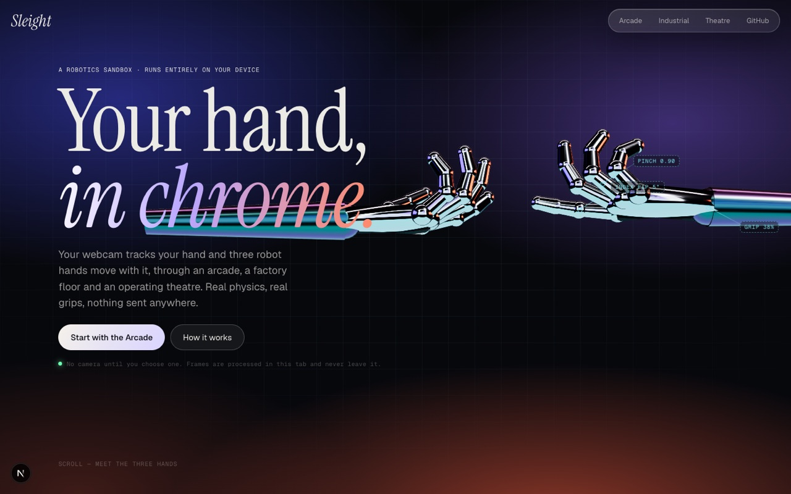
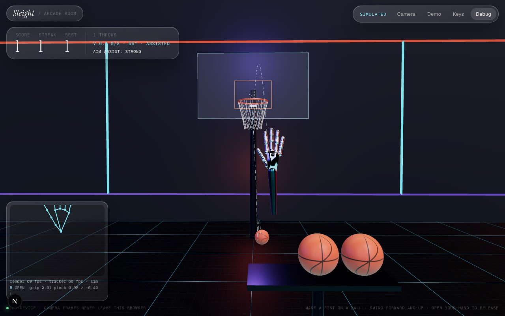
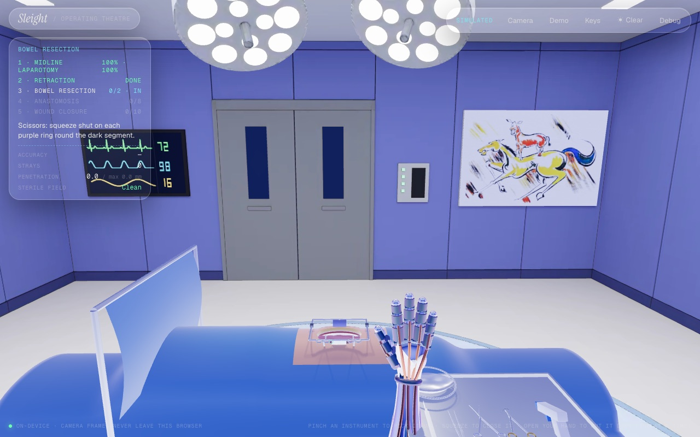
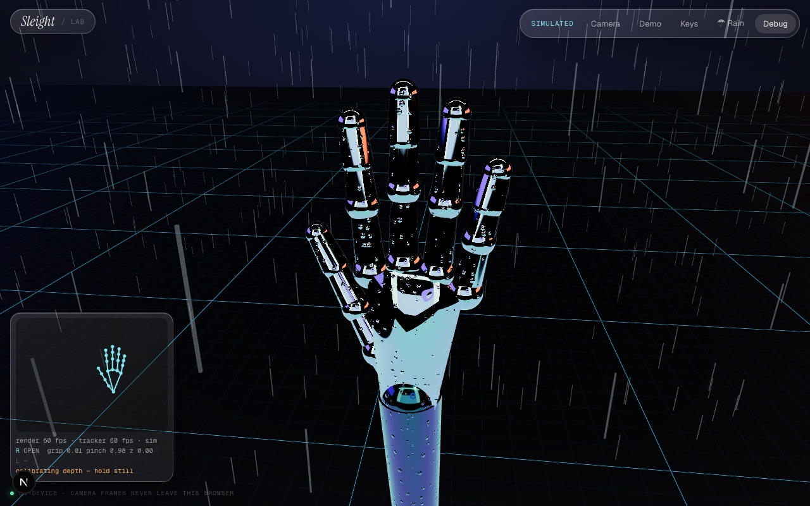

# Sleight

[](https://github.com/Omkarshinde19/sleight/actions/workflows/ci.yml)

A browser robotics sandbox. Your hand, tracked by your webcam, drives chrome robot hands through two
physics scenes: an arcade and an operating theatre.

**100% client-side.** The hand tracker (MediaPipe) runs as WASM in your tab, and its model and runtime are
served from this site rather than a CDN. Webcam frames are never uploaded: there is no server to send them to.



## What's in it

- **Landing page.** A scroll story of the three hands, before anything asks for the camera. Chrome hands
  re-pose for each chapter, and blueprint callouts track live joint angles, pinch and grip.
- **Arcade Room** (`/arcade`). Cup a basketball with a half-closed hand, the way you'd really hold one. It
  stays in your hand until your fingers open. Opening slowly drops it; a sudden flick as you open throws it
  with your hand's recent velocity: a least-squares fit over the fastest 120 ms (and at least four tracker
  frames) before release. Brushing
  the rack can't knock balls off, and dropped or missed balls go back to their cradles. It scores
  only when it drops down through the rim. You get streaks, a hoop that starts to drift from a streak of 3,
  dashed trajectory arcs and an aim assist (off / fair / strong).
- **Operating Theatre** (`/theatre`). A bowel resection in a Blender-built operating room (baked
  Cycles lighting, twin surgical lights, vitals on the wall). Five steps: open the abdomen along the
  purple guide (skin, then fascia: nothing is cut off the guide), seat a Balfour retractor, cut out the
  dead segment of bowel with scissors and lift it into the kidney dish with forceps, stitch the healthy
  ends together with the needle driver, and staple the skin. One instrument at a time, picked up with a
  pinch and closed with a squeeze; put down, it goes back to the Mayo tray. Holding one, slow moves are
  scaled down by half, like a surgical robot's motion scaling, and the hand leans forward over the
  patient. Tools stop at tissue, with
  live penetration from the physics contacts; a hand inside the patient raises a sterile-field breach.
  The HUD scores accuracy, strays off the guides and breaches.
- **Weather in every scene.** Rain beads on the chrome and dries when it stops; snow settles on the
  knuckles and melts.
- **Lab** (`/lab`). A bare bench for checking tracking, with the debug overlay open.

| Arcade | Theatre | Rain |
|---|---|---|
|  |  |  |

## Run it locally

Needs Node 20+. Then open http://localhost:3000.

```bash
npm install
npm run dev
```

`npm install` also copies MediaPipe's WASM into `public/mediapipe/` (see `scripts/copy-mediapipe.mjs`).
The hand model is committed at `public/models/hand_landmarker.task`. **No API keys, no `.env`.**

Camera access needs `localhost` or HTTPS. To try it on a phone, use the deployed URL.

## How to demo

1. Open the landing page and scroll through the three hands. Nothing asks for the camera yet.
2. Click **Start with the Arcade** and choose **Use my camera**. Allow the camera.
   - Hold your hand up about 50 cm from the camera for a second. Depth calibrates on the first frames
     (**Calibrate** redoes it).
   - Good light from the front works best. A bright window behind you makes tracking harder.
3. **Arcade:** bring your hand onto a ball and close it halfway, like holding a real basketball. Flick
   forward *and up* and open your fingers to shoot. Open slowly and it just drops back to the rack. Aim
   assist defaults to *strong*; the HUD button cycles it.
4. **Theatre:** pinch the scalpel and draw it along the purple line on the abdomen, twice (skin, then
   fascia). Carry the Balfour retractor to the wound and let go. Squeeze the scissors shut on each purple
   ring, then lift the dark segment into the kidney dish with the forceps. Touch the needle to each
   glowing dot, then squeeze the stapler on each mark. The HUD says what's next at every step.
5. **☂ Rain** and **❄ Snow** are in the top bar. **Debug** shows the landmark skeleton over your camera,
   gesture, fps, tracker latency and what each hand is holding.

**No webcam, or the room's lighting is bad?** Every scene has two fallbacks:

- **Simulated hand:** the mouse moves it, click (or Space) grabs, Shift+click pinches, the wheel or R/F
  sets depth, 1–5 picks open / pinch / fist / point / claw, T throws, Q/E · W/S · A/D rotate, and Tab switches
  hands. **Keys** in the top bar lists them all.
- **Demo recording:** a recorded real session plays in a loop.

Add `?source=sim`, `?source=demo` or `?source=camera` to a scene URL to skip the chooser, and `?debug`
to open the overlay.

On a phone, use landscape. Phones track one hand, laptops track two.

## Architecture

```
webcam ─▶ CameraSource (MediaPipe HandLandmarker, WASM, GPU → CPU fallback)
sim    ─▶ SimulatedSource (parametric hand → same 21 landmarks)          ─┐
replay ─▶ PlaybackSource (recorded JSON)                                  │
                                                                         ▼
                              HandProcessor: One Euro smoothing · depth from apparent palm size
                              · gestures with hysteresis + dwell · scene-space joints · motion history
                                                                         │  zustand store (read in useFrame)
                         ┌───────────────────────────────────────────────┼──────────────────────┐
                    RobotHand (render)           HandPhysics (Rapier): kinematic palm + fingertip
                                                 colliders · grab system (fixed / spring joints, or
                                                 velocity "drive" for tools) · throw velocity
```

| Path | What |
|---|---|
| `src/lib/hand/` | Pure maths, unit-tested: landmark types, One Euro filter, gesture classifier, throw velocity, depth, scene mapping, the synthetic hand |
| `src/lib/tracking/` | Camera, simulated and playback sources; recorder; `HandProcessor` |
| `src/lib/physics/` | Collision layers, aim assist (ballistics), incision scoring |
| `src/lib/materials/chrome.ts` | Iridescent chrome with the weather shader (droplets, snow) |
| `src/components/physics/HandPhysics.tsx` | Hand colliders and the grab system |
| `src/components/scene/` | Shared scene shell, studio lighting, floor |
| `src/scenes/{arcade,theatre}` | The two scenes, each a lazy, client-only route |
| `src/components/landing/` | Landing page and its 3D stage |

### Design decisions worth knowing

- **Rapier, not cannon-es.** Kinematic hands report real velocity, CCD stops thin tools tunnelling, and
  contacts stop surgical tools at tissue. See [docs/PLAN.md](docs/PLAN.md) for the comparison.
- **Grabs are joints, never teleports.** Balls use a fixed joint to the hand's anchor.
- **Tools never clip.** A kinematic body goes wherever it is told, CCD or not. So surgical tools are
  dynamic bodies whose velocity is steered toward the hand every physics step. The contact solver stops
  them at tissue, with stiffer contacts and soft CCD in that scene.
- **MediaPipe depth is weak.** Depth comes from apparent palm size: image length ÷ metric length, taking
  the largest of four palm segments, which limits foreshortening. It is calibrated from the first steady
  second (judged by speed per second, so it works at any tracker rate), or after 4 s from the typical
  distance if the hand never holds still, and smoothed harder than x/y.
- **Grabs don't flicker.** Each gesture has an enter and a looser exit threshold, and must win for 60 ms
  (and two frames) before it switches.
- **The tracker shares the GPU with the scene.** In a heavy scene MediaPipe's GPU delegate measured
  45–70 ms a frame (11–19 fps). So the worker times the GPU and CPU delegates on the first frames with a
  hand and keeps the faster one (remembered per page), frames are capped at 640 px wide, the Theatre
  tracks one hand (with two, the palm detector runs every frame looking for the second), and the canvas
  drops to 1x pixels if the tracker stays under 20 fps. The middle 84 % of the camera frame covers the
  whole workspace, so reaching the edges of a scene doesn't take your hand out of view.

## Tests

```bash
npm test            # Vitest: gestures, throw maths, aim assist, depth, mapping, incision scoring
npm run typecheck
npm run lint
npm run test:e2e    # Playwright: drives every scene with the simulated hand (needs a GPU; run locally)
```

The gesture and smoothing tests run on **real webcam landmarks** (`src/lib/hand/__fixtures__/`), recorded
from a 38 s MacBook clip run through the tracker in Chromium as a fake camera. Only landmark numbers are
committed, never footage. `scripts/record-from-video.mjs` reproduces this from any clip.

CI runs the type check, lint, unit tests and production build on every push. The e2e tests need real GPU
WebGL, because physics advances per rendered frame, so they run locally.

## Deploy (Vercel)

It's a static Next.js app with no environment variables.

1. On vercel.com: **Add New → Project**, then import `Omkarshinde19/sleight`.
2. Keep the detected defaults (framework: Next.js, build: `npm run build`), then **Deploy**.

The tracker model and WASM are cached as immutable assets (`next.config.ts`).

## What's verified, and what isn't

- **Verified in a browser:** every scene with the simulated hand and the recorded session (e2e). The real
  MediaPipe pipeline on a recorded webcam clip: GPU delegate, ~30 tracker fps, ~20 ms per frame. Grabs,
  throws, scoring, tool penetration, incisions and forceps retrieval.
  Rain and snow, the landing page, and phone-sized layouts. 60 fps on an Apple-silicon MacBook in
  production mode.
- **You need to try:** a live webcam in your room's lighting; how throwing *feels* with your own arm
  (gains are in `src/scenes/arcade/Balls.tsx`); an iPhone in Safari (the layout is checked, but live
  tracking speed on the device isn't); and performance on a mid-range Windows laptop.
- **Refreshing:** the tab remembers that it was using the camera and resumes it if permission is already
  granted. Depth calibration is taken from steady frames only, saved, and restored after a reload. If
  the camera is still held by the previous page, it retries a few times.
- **Known limits:** in the Arcade the robot hands are kept out of the rack, its stand, the balls and the
  floor (a cyan ghost shows where your real hand is), but in the Theatre they can still pass
  through the furniture. Tracking is weakest with strong backlight and side-on pinches. A tool glancing the patient at full
  speed can momentarily overlap by a few mm before the solver pushes it out (shown as *max* in the
  Theatre HUD).

## Credits

MediaPipe Tasks Vision (Apache-2.0), three.js, @react-three/fiber and drei, Rapier and
@react-three/rapier, Next.js. Built for an RAL robotics submission.

Licensed under [MIT](LICENSE).
